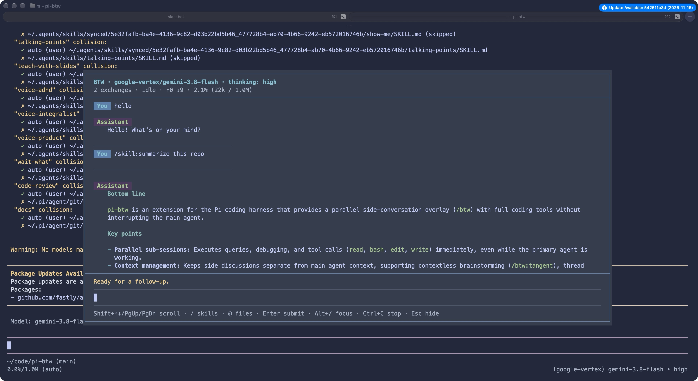

# pi-btw

A [pi](https://github.com/earendil-works/pi-mono) extension for parallel `/btw`
side conversations. It opens a centered floating overlay backed by a real Pi
sub-session with `read`, `bash`, `edit`, and `write` tools, and runs
immediately even while the main agent is mid-turn.



## Install

From GitHub:

```bash
pi install git:github.com/Integralist/pi-btw
```

From a local checkout:

```bash
pi install /absolute/path/to/pi-btw
```

Reload Pi after installing:

```txt
/reload
```

## Quick start

```txt
/btw what file defines this route?
/btw --save summarize the last error in one sentence
/btw --model gpt-5-mini --thinking low what are the risks here?
/btw:tangent brainstorm without the current main-thread context
/btw:inject implement the plan we just discussed
/btw:summarize hand back a short summary of this side thread
```

## Commands

Run these from the main Pi prompt. Inside the overlay, bare `/new`, `/tangent`,
`/clear`, `/inject`, `/summarize`, `/thinking`, `/model`, `/debug`, `/copy`,
and `/sync` also work directly.

- **`/btw [--model <m>] [--thinking <t>] [--save] <question>`:** Ask in the
  contextual BTW thread.
- **`/btw:new [flags] [question]`:** Start a fresh contextual thread.
- **`/btw:tangent [flags] [question]`:** Start a contextless side thread.
- **`/btw:debug [on | off | <question>]`:** Toggle thinking and tool output.
- **`/btw:thinking [<level> | clear]`:** Show, set, or clear thinking level.
- **`/btw:sync`:** Pull new parent messages into the active BTW thread.
- **`/btw:copy`:** Copy the last BTW reply to the clipboard.
- **`/btw:inject [instructions]`:** Send the full BTW thread to the main agent.
- **`/btw:summarize [instructions]`:** Summarize and send to the main agent.
- **`/btw:clear`:** Reset the BTW thread and close the overlay.

Short flags `-m`, `-t`, and `-s` alias `--model`, `--thinking`, and `--save`.

## Overlay features

- **Multi-line composer:** Wraps long prompts, preserves drafts on hide, and
  supports prompt history and undo.
- **Skill autocomplete (`/`):** Typing `/` fuzzy-searches your Pi skills and
  expands the selected `SKILL.md` on submit while keeping the transcript short.
- **File autocomplete (`@`):** Typing `@` fuzzy-searches files under the
  current working directory (using `fd` when available).
- **Model picker (`/model`):** Inside the overlay, `/model` lists physical
  models matching your Pi `enabledModels` setting (or all authenticated
  physical models if unset). Use `/model <query>` to switch or `/model clear`
  to inherit the main thread again.
- **Thinking picker (`/thinking`):** Inside the overlay, `/thinking` lists
  supported levels for the active model with `*` on the active one. Use
  `/thinking <level>` or `/thinking clear` to change it directly.
- **Context seeding & isolation:** Contextual threads (`/btw`, `/new`) seed an
  isolated in-memory sub-session from the main branch: they keep the initial
  goal plus the last 25 messages (aligned to a user turn), strip parent
  thinking blocks, and cap parent tool outputs at 1,000 characters. Tangent
  threads (`/tangent`) start with no parent context.
- **Context management & sync:** BTW turns persist as hidden session entries
  outside the main agent's context, replay after parent context on reload, and
  can pull new parent messages anytime with `/sync`. Nothing enters the main
  agent's context unless you run `/inject` or `/summarize`.
- **Context & compaction status:** The header shows live BTW context usage (for
  example `2.1% (22k / 1.0M)`), and the status line surfaces threshold and
  overflow compaction progress.

## Keyboard controls

- **`Alt+/` or `Ctrl+Alt+W`:** Toggle focus between overlay and main editor.
- **`Shift+Up` / `Shift+Down`:** Scroll transcript line by line.
- **`PgUp` / `PgDn`:** Scroll transcript by page.
- **`Up` / `Down`:** Move cursor, navigate autocomplete, or browse history.
- **`Tab`:** Accept autocomplete suggestion.
- **`Enter`:** Submit prompt (or confirm picker / `/` skill).
- **`Ctrl+C`:** Clear non-empty input, or abort active BTW turn.
- **`Esc`:** Close autocomplete menu, or hide overlay.

## How state and models work

- **Isolated context:** BTW threads are saved as hidden custom session entries
  so they survive reloads and branch switches without entering the main agent's
  context. Use `--save` when you want a single reply visible in the main
  transcript.
- **Parent context pruning:** Contextual `/btw` threads seed from the main
  branch (keeping the initial goal and recent 25 messages, with tool outputs
  capped at 1,000 characters).
- **Physical model resolution:** BTW inherits the active physical model and
  effort level. If the main thread uses a virtual router, BTW resolves the last
  successful physical assistant message on the branch; if none exists, pass
  `--model <provider/id> --thinking <level>`.
- **Assistant model switching:** BTW exposes a `configure_btw` tool so you can
  still ask the assistant to switch its own model or thinking level when
  needed; normal prompts starting with words like `use` or `model` are never
  intercepted.
